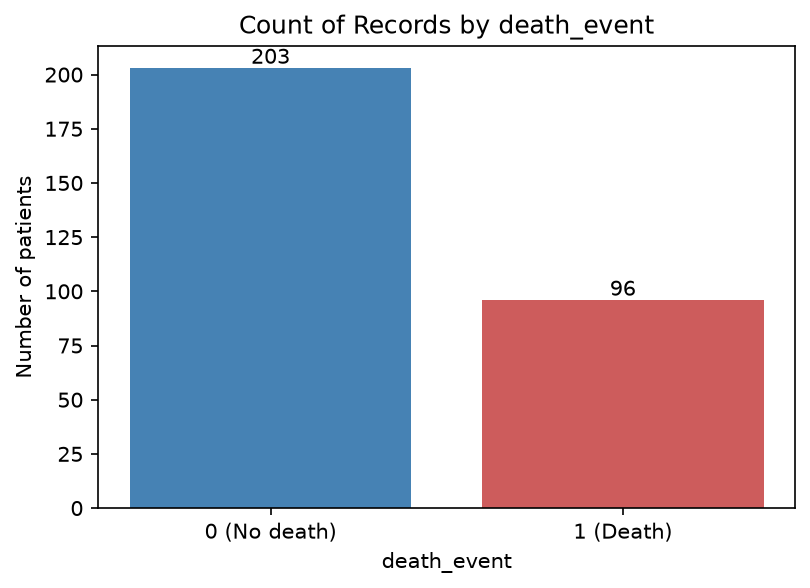
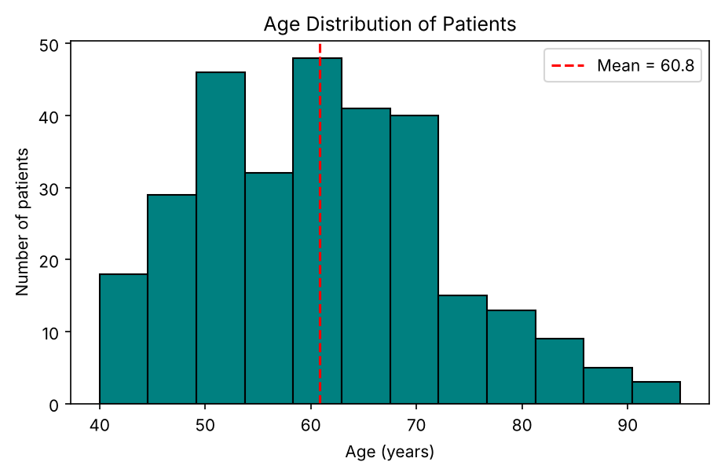

# Heart Failure Records – Exploratory Data Analysis

Basic descriptive EDA of the Heart Failure Clinical Records dataset using **Python, NumPy and Pandas**.
This is a data-handling exercise only: no machine learning and no clinical recommendations.

**Author:** Sachin Rathore (Roll No. 2026B01010744)

## Problem
The raw dataset lists individual patient records. This project finds out how patients are distributed by age,
how many had a death event, how ejection fraction and serum creatinine differ between the death_event groups,
how common diabetes, high blood pressure and anaemia are, and whether the data has missing values or duplicates.

## Dataset
- Source: [UCI Machine Learning Repository – Heart Failure Clinical Records (ID 519)](https://archive.ics.uci.edu/dataset/519/heart+failure+clinical+records)
- 299 rows, 13 columns (all numeric)
- Raw file: `data/raw/heart_failure_clinical_records_dataset.csv`
- Cleaned file: `data/processed/heart_failure_clean.csv` (column `DEATH_EVENT` renamed to `death_event`, `age_group` added)

## Steps
1. Load the data and inspect it with `head()`, `tail()`, `shape`, `info()`, `describe()`
2. Check missing values and duplicates
3. Age distribution and summary statistics (NumPy + Pandas)
4. Count records by `death_event`; compare group averages with `groupby()`
5. Count records with and without diabetes, high blood pressure and anaemia
6. Filtering and sorting, then two charts

## Key findings
- No missing values and no duplicate rows. Ages range from 40 to 95 (mean 60.8, median 60).
- 203 records have death_event = 0 (67.9%) and 96 have death_event = 1 (32.1%).
- The death_event = 1 group has a lower average ejection_fraction (33.5 vs 40.3) and a higher average serum_creatinine (1.84 vs 1.18). This is descriptive only and does not show cause.
- Diabetes: 125 records, high blood pressure: 105 records, anaemia: 129 records.

## Charts



## How to run
```bash
pip install -r requirements.txt
python scripts/prepare_data.py          # optional: rebuilds the processed CSV
cd notebooks
jupyter notebook heart_failure_eda.ipynb
```

## Project structure
```
heart-failure-records-eda/
|-- data/
|   |-- raw/heart_failure_clinical_records_dataset.csv
|   `-- processed/heart_failure_clean.csv
|-- notebooks/heart_failure_eda.ipynb
|-- images/ (saved charts)
|-- scripts/prepare_data.py
|-- docs/Individual_Project_SRS_Sachin_Rathore.docx
|-- requirements.txt
|-- .gitignore
`-- README.md
```
